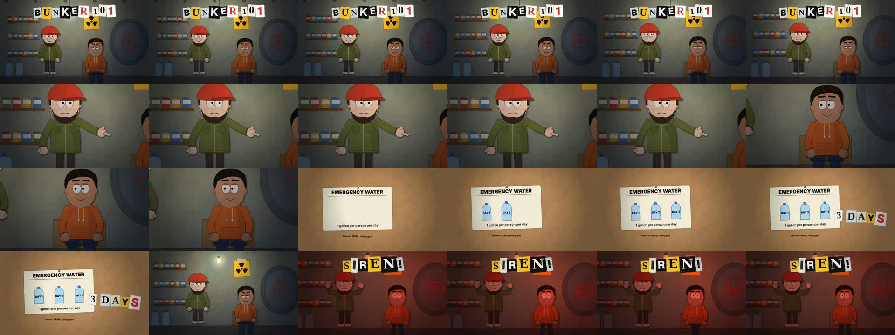

# USA Survive

Animated survival stories for a US audience — zombie outbreaks, nuclear strikes, bunkers, disasters — as long-form (7–8 min) horizontal cartoons.

Everything is drawn **with code** (canvas + JS, rendered with HyperFrames) in the **"Applique"** style: cut-paper characters in the spirit of early *South Park*, collage inserts on cork boards, ransom-note lettering, stop-motion on twos, synthesized music and sound design. No generative images.

- `docs/demo.mp4` — 14-second engine demo (bunker, fact card, siren).
- Instructions for Claude Code — `CLAUDE.md` and `.claude/skills/` (in Russian).
- Quick start: `bash tools/setup.sh`, then `tools/make.sh demo snap 1,4.5,9.5,12.5` → `build/demo/snaps/sheet.jpg`.
